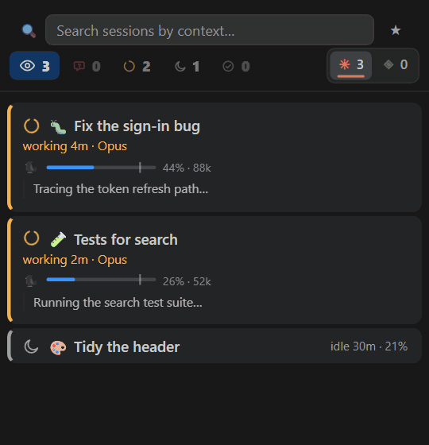

# Overlord (fork)

A live board of every Claude Code and Codex session you have running, inside
the VS Code or Cursor sidebar. One card per session shows whether it needs you,
is working, or is done, and one click takes you to it.

> **This is a fork of [overlord-vscode](https://github.com/JanaToskovic/overlord-vscode)
> by jana, with about 100 changes by Joel Kahn.** The original idea, the board and
> the session detection are hers. Licensed MIT, like the original.



## Why I built it

I run a lot of agent sessions side by side, and I kept losing track of which one
was waiting on me. The original Overlord solved half of that. I kept adding what I
needed every day until the board told me, at a glance, where my attention should go.

## What the fork adds

- **Needs-you detection** that reads the end of each turn: questions, approval
  dialogs, and finished turns that still hand you something to do
- **Summary cards** that show the last message's summary, the model, context
  used and token spend
- **Helper rows**: background agents and subagents grouped under their parent
  session, with the model each one ran on
- **Codex sessions** on the same board, next to Claude Code
- **Tabs and sections** (Needs you, Working, Done), park and un-park, rename,
  and caps so old sessions don't pile up
- **Concept search** over the board (optional, uses Claude Haiku)
- **Topic icons** on each card from its title
- **Codex usage bar** with the plan's remaining allowance and reset time, read
  from Codex's local session files
- **Memory bar** for the machine, with the biggest apps
- **Jump and reply**: click a card to focus its terminal, or send text to it
- **Hand off** button for long sessions (optional, needs your own handoff script)
- OS toast notifications, sound and pop-up alerts, all switchable in settings

## Requirements

- VS Code or Cursor
- [Claude Code](https://claude.com/claude-code) on your `PATH`, v2.1 or newer
- Optional: Python 3 for search, topic icons and helper grouping
  (set `OVERLORD_PYTHON` if `python` is not on your `PATH`)

## Build and install

There is no build step; the source is plain JavaScript.

```
npx @vscode/vsce package
code --install-extension overlord-vscode-2.1.8.vsix
```

Then reload the window and open the eye icon in the activity bar.

## Settings

All settings are under `overlord.*` in VS Code settings (poll interval, alerts,
models used for judging and summaries, the new-session command, and more).

Two environment variables are optional:

- `OVERLORD_PYTHON`: the Python used for the helpers in `python/`
- `OVERLORD_WORKSPACE`: a folder whose `_temp/` holds state files from your own
  hooks (loop registry, plan gate, task archive, `hooks/handoff-gate.py`).
  Leave it unset and those extras stay off.

## Privacy

Overlord reads Claude Code's local session transcripts on your machine. By
default, its short model calls (judging whether a session needs you, summarising
cards, ranking search results, picking topic icons) run through your own
`claude` CLI, which signs in the normal way. These calls send card titles and
recent session text to Anthropic. It does not read your plan usage, subscription
or profile.

`overlord.useClaudeCodeLogin` is off by default. Turned on, it makes those calls
faster by reusing Claude Code's saved login in `~/.claude/.credentials.json` to
call Anthropic's Messages API at `api.anthropic.com` directly; the token is never
sent to any other host. Reusing the login this way may conflict with Anthropic's
consumer terms, which is why it stays off unless you turn it on.

If no model call works, everything that needs one simply turns off. You can turn
the judge off with `overlord.judgeWithHaiku`.

## Tests

`node test-transcript.js`, `node test-codex.js` and `node test-login-optin.js` are
small assertion scripts.

## License

MIT. See `LICENSE.txt`. Original work copyright jana; fork changes copyright
Joel Kahn.
